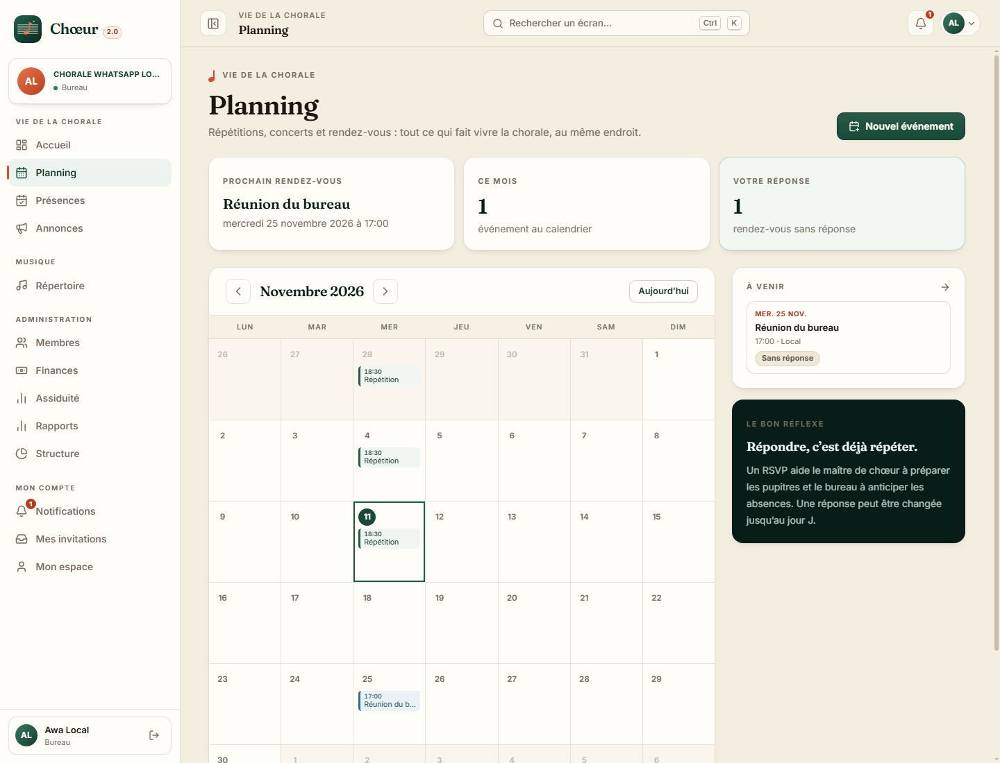
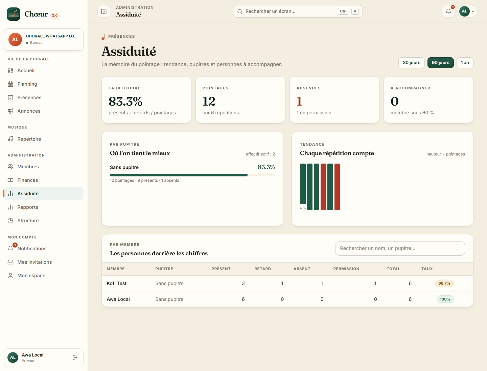

# Chœur 2.0 — brief de refonte visuelle

> Document de référence pour les agents qui touchent `chm-frontend/`.
> Objectif : **refonte complète, originale, cohérente et accessible** de
> l'interface ChoirManager, sans renier le produit ni casser sa mécanique.

## 1. Positionnement

Chœur est un outil de gestion de chorale. L'interface doit dire **musique,
papier, chaleur humaine et sérieux du bureau** — pas « dashboard SaaS violet ».
La promesse : le bureau ouvre l'outil le soir avant la répétition et comprend en
trois secondes qui vient, ce qui se répète, ce qui reste à encaisser.

Direction artistique : **« Papier & scène »**. Papier ivoire, encre chaude,
vert pin profond (institution, nature, Afrique de l'Ouest), corail terre cuite
(la scène, l'humain), or discret (les cuivres). Motifs de portée musicale,
typographie éditoriale, ombres douces, aucune surcharge.

## 2. Jetons (à implémenter dans `src/styles.css`, bloc `@theme`)

Ces valeurs **remplacent** la palette indigo/ambre actuelle. Les classes
existantes `primary-*` et `accent-*` gardent leurs noms : les templates sont
ainsi recolorés d'un coup, proprement.

```text
primary (vert pin)   50 #edf4f0  100 #d8e8df  200 #b3d2c2  300 #86b7a0
                     400 #5a987e 500 #3a7c62  600 #1f5c46  700 #174a38
                     800 #123b2e 900 #0e2d24  950 #081d17
accent (corail)      50 #fdf0eb  100 #fbe0d5  200 #f7c0ac  300 #f09b7d
                     400 #e8734e 500 #d94f2b  600 #b73e1e  700 #933119
                     800 #742717 900 #5c2114  950 #32100a
background #f4eee1  surface #fffdf8  surface-2 #f7f1e4
text-main #1a1712   text-muted #756c5d  line rgba(26,23,18,.12)
ok #2b7a52 | warn #a4680f | danger #ad3a2b | info #2e5b8a
```

Rayons : `--radius-sm: 8px`, `md: 12px`, `lg: 16px`, `xl: 22px`.
Ombres : très douces, teintées encre (`0 1px 2px rgba(26,23,18,.05), 0 14px 34px -22px rgba(26,23,18,.45)`).

**Typographie** — auto-hébergée, aucune requête tierce (CSP) :
- affichage : **Fraunces Variable** (titres `h1`–`h3`, gros chiffres, nom de
  marque) — `font-variation-settings: "SOFT" 40, "WONK" 0`, letter-spacing
  légèrement négatif ;
- interface : **Inter Variable** (corps, formulaires, tableaux, labels) ;
- chiffres : `font-variant-numeric: tabular-nums` sur toute donnée chiffrée ;
- supprimer les `<link>` Google Fonts de `index.html` et ses `preconnect`.
  Copier les `.woff2` nécessaires depuis `node_modules/@fontsource-variable/…`
  vers `public/fonts/`, et déclarer les `@font-face` dans `styles.css`.

## 3. Langage visuel

- **Motif de portée** : filet de 5 lignes fines (17 px) comme séparateur /
  décor d'en-tête, en CSS (`repeating-linear-gradient`), jamais en image.
- **Note** : petit pictogramme tête + hampe en CSS ou SVG inline, accent corail.
- **Eyebrow** : label capitales 11 px, interlettrage 0.14em, muted, au-dessus
  des titres de page.
- **Titres éditoriaux** : `h1` en Fraunces 600, 30–40 px desktop ; le titre de
  page porte une phrase courte et un sous-titre explicite (max 68 caractères
  utiles par ligne).
- **Cartes** : surface chaude `#fffdf8`, bord 1 px `line`, rayon 16 px, ombre
  discrète. Variantes : teintée pin (information), dorée (échéance), corail
  (alerte douce), encre (bandeau fort). **Interdit : trois cartes identiques
  alignées en grille.**
- **Chiffres** : très grands en Fraunces, unité en petit ; jamais de gris clair
  sur fond ivoire (contraste AA minimum, 4.5:1).
- **Boutons** : 40 px, rayon 10 px, 600. Primaire = pin, accent = corail,
  fantôme = bord `line`. Icônes lucide 17 px, jamais d'emoji.
- **Badges** : pilules 22 px, point coloré optionnel, libellés français.
- **Tableaux** : en-têtes capitales 11 px muted, lignes 1 px `line`, hover
  `surface-2`, chiffres alignés à droite, actions en fin de ligne.
- **États** : skeleton (jamais de spinner plein écran), vide illustré (icône en
  médaillon + phrase utile + action), erreur avec réessai, succès en toast.

## 4. Coquille de l'application

**Desktop ≥ 1024 px** : rail latéral 260 px (replié 80 px, préférence
mémorisée). Marque « Chœur » + badge `2.0` en Fraunces. Bascule de chorale en
carte. Navigation groupée (Vie de la chorale / Musique / Administration),
item actif = fond `primary-50`, indicateur corail 3 px à gauche, icône pin.
Bas : carte utilisateur + déconnexion.

**Barre supérieure** 68 px, sticky, fond papier translucide + blur léger :
fil d'Ariane contextuel, recherche globale (ouvre une palette de commandes
`Ctrl/⌘ K` : navigation + actions rapides), cloche avec compteur, menu compte
(Mon espace, thème, déconnexion).

**Mobile < 768 px** : barre inférieure 5 destinations (Tableau de bord,
Présences, Pointage central surélevé corail, Répertoire, Plus) ; safe-area iOS ;
contenu scrollable, titres plus compacts, tableaux transformés en cartes si
nécessaire.

## 5. Écrans prioritaires

1. **Connexion** : split éditorial — à gauche une composition typographique
   (citation de chorale, portée, note), à droite la carte de formulaire. Pas de
   fond dégradé. Lien retour à l'accueil, mentions légales discrètes.
2. **Tableau de bord** : bandeau d'accueil (salutation, date longue, prochaine
   répétition avec action « pointer »), anneau d'assiduité, solde de caisse,
   cotisations, chants maîtrisés ; colonne « Aujourd'hui » (agenda + à faire) ;
   activité récente. Hiérarchie claire, pas de grille uniforme.
3. **Pointage** : cartes de choristes en grille, grandes zones tactiles, statut
   coloré (présent pin, retard or, absent corail, excusé gris), compteurs
   sticky, mise à jour optimiste immédiate. Doit se faire à une main.
4. **Membres** : liste dense mais respirable, recherche + filtres en chips,
   avatar à initiales, rôles en pastilles. Fiche : en-tête identitaire, onglets
   (présences, mandats, cotisations, notes staff).
5. **Répertoire** : cartes de chants avec tonalité, statut d'apprentissage
   (segment de progression), médias ; lecteur audio soigné.
6. **Finances** : solde en grand, entrées/sorties, graphique lisible (barres
   CSS/SVG léger), journal filtrable, cotisations avec progression par campagne.
7. **Rapports** : mise en page « document », bouton imprimer (CSS print),
   exports CSV explicites.
8. **Pages publiques** : landing avec la même identité, sections aérées,
   preuve sociale, appel à l'action « Demander une chorale » / « Se connecter ».
9. **Opérateur** : tableau des chorales, statut de suspension, journal d'audit
   lisible, corbeille avec restauration.

## 6. Règles Angular et non-régression

- **Ne pas renommer** composants, sélecteurs, routes, services, signaux,
  `data-testid`, ni les méthodes publiques utilisées par les specs.
- Les templates sont **inline** dans les `.ts` : modifier le template, pas
  l'architecture. Pas de nouveau NgModule. Standalone + signals uniquement.
- Conserver toute la logique existante (guards, optimistic update du pointage,
  `MediaProtegeDirective`, sélecteur de chorale, refresh token, bascules de
  tenant). La refonte est visuelle et ergonomique, **pas** un changement de
  comportement — sauf amélioration explicitement demandée.
- Toute nouvelle interaction doit rester accessible : focus visible, `aria-*`,
  navigation clavier, `prefers-reduced-motion`.
- Textes en français, accents compris. Code (classes, variables) en anglais.
- Avant de rendre : `npm run build` et `npm test` doivent passer. Si un test
  échoue pour une raison purement visuelle (classe/texte), mettre à jour le
  test **sans affaiblir** l'assertion comportementale ; ne jamais supprimer un
  test.
- `styles.css` est édité par un seul agent (propriétaire du design system).
  Les autres ajoutent d'éventuels styles locaux dans le tableau `styles:` de
  leur composant, ou utilisent les classes globales existantes.

## 7. Ce qu'on ne fait pas

Pas de dark mode (risque de rendu incohérent sur des centaines de classes
Tailwind utilitaires), pas de bibliothèque UI supplémentaire, pas de
dégradés violets, pas d'emojis, pas de spinner plein écran, pas de
`!important` en série, pas de renommage de classes déjà utilisées par les
tests sans vérifier les specs.

## 8. Extension « Planning & assiduité » (branche étape 2)

Deux écrans ajoutés sans second système de design : mêmes polices, même
palette, mêmes composants de coquille. Le calendrier réutilise la grille
papier et les couleurs de nature (vert = répétition, corail = concert, bleu =
réunion, ocre = audition). L'analytique emploie les mêmes cartes et badges,
avec des barres de taux et une série de pointages — pas de bibliothèque de
graphiques.





Principes tenus : navigation identique (Planning dans « Vie de la chorale »,
Assiduité dans « Administration » pour bureau/MDC), aucune route ni
`data-testid` renommés, états chargement/vide/erreur explicites, et actions
RSVP accessibles au clavier dans une modale.

## 9. Recette mobile et modales (étape 2)

Les correctifs de recette ont porté sur des défauts transverses, pas seulement
sur Planning :

- les modales sont rendues au-dessus de la coquille : `.route-enter` ne
  conserve plus de contexte d'empilement après son animation, et un panneau
  plus haut que le viewport reste atteignable par le haut ;
- les icônes de recherche ne sont plus positionnées en double (le SVG héritait
  du `absolute` du composant `lucide-icon`) ; le retrait des champs avec icône
  vit dans `.input--icon-left` ;
- sous 640 px, le calendrier Planning devient un agenda lisible plutôt qu'une
  grille de sept colonnes ; les KPI d'assiduité passent en deux colonnes ;
- les filtres du répertoire s'empilent en pleine largeur sur mobile ;
- l'analytique expose un filtre par pupitre et un export CSV (BOM UTF-8,
  séparateur `;`), et `/rapports` renvoie vers elle pour les rôles autorisés.

Captures : [mobile-planning.png](captures/mobile-planning.png),
[mobile-planning-agenda.png](captures/mobile-planning-agenda.png),
[mobile-assiduite.png](captures/mobile-assiduite.png),
[modal-planning-mobile.png](captures/modal-planning-mobile.png),
[modal-musique-mobile.png](captures/modal-musique-mobile.png).

## 10. Récurrences et SMS (étape 2)

Le formulaire « Nouveau rendez-vous » porte désormais une section
**Récurrence** : fréquence, intervalle, jours (hebdomadaire), date de fin.
La liste **Récurrences** permet de régénérer ou d'arrêter une série. Une
occurrence reste éditable individuellement depuis sa fiche (Modifier /
Annuler l’occurrence) ; une occurrence éditée ou annulée n’est jamais écrasée
par une régénération.

Le drapeau **Envoyer aussi un SMS** est explicite et désactivé par défaut : le
SMS est un canal payant. Il n’est proposé que pour les événements/séries, pas
pour les annonces générales.

Captures : [planning-recurrence-form.png](captures/planning-recurrence-form.png),
[planning-series-modal.png](captures/planning-series-modal.png),
[mobile-planning-recurrence-form.png](captures/mobile-planning-recurrence-form.png).

### Récurrence mensuelle par occurrence

Le formulaire mensuel propose maintenant **Jour de la semaine** + **Occurrence**
(`1er`, `2e`, `3e`, `4e`, `Dernier`) en plus du mode « même jour du mois ».
Cela couvre directement « dernier vendredi de chaque mois », sans créer une
occurrence au dernier jour puis la déplacer à la main.
